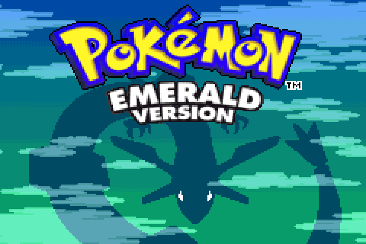
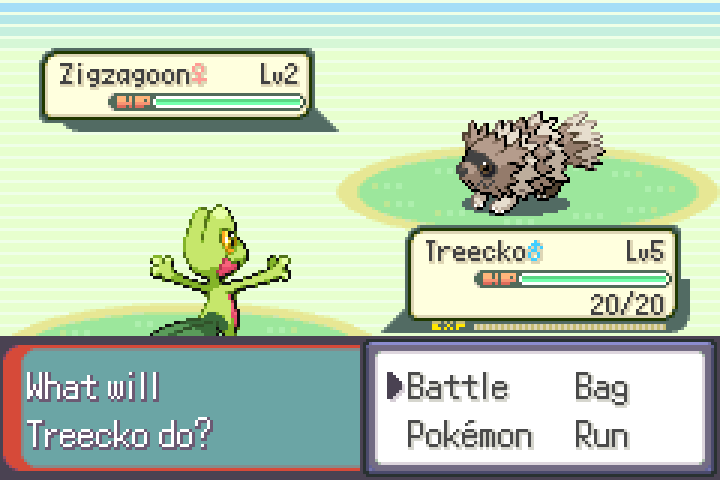

# pokeemerald-expansion-native

[](https://github.com/uehlbran/pokeemerald-expansion-native/actions/workflows/native.yml)
[](LICENSE)

A native PC build of [pokeemerald-expansion](https://github.com/rh-hideout/pokeemerald-expansion),
rh-hideout's fork of the Pokémon Emerald decompilation, running as an
ordinary Linux or Windows executable. No emulator and no ROM are involved:
you build it from this repository, and no build is published.




## Get started

You build the game yourself; no download exists. New to this? [Every step is explained](docs/GETTING-STARTED.md).

**Windows 10 or 11**

1. In PowerShell, opened as administrator, install Ubuntu, then restart:

   ```
   wsl --install -d Ubuntu-24.04
   ```

2. In the Ubuntu window that opens, install what the build needs:

   ```
   sudo apt update
   ```

   ```
   sudo apt install -y build-essential git python3 pkg-config curl clang gcc-multilib libpng-dev libsdl2-dev gcc-mingw-w64-x86-64 binutils-mingw-w64-x86-64
   ```

3. Download the code and build the Windows game:

   ```
   git clone --depth 1 https://github.com/uehlbran/pokeemerald-expansion-native.git
   ```

   ```
   cd pokeemerald-expansion-native
   ```

   ```
   tools/build-native.sh --os windows
   ```

4. Open the result in Explorer:

   ```
   explorer.exe build/native64-windows
   ```

   Copy `pokeemerald-native.exe` and `SDL2.dll` into a new folder on the
   Desktop and double-click the `.exe`. If Windows says "Windows protected your
   PC" (the executable is not signed), click "More info", then "Run anyway".

Every step explained: [docs/GETTING-STARTED.md](docs/GETTING-STARTED.md#windows-10-or-11).

**Linux (Ubuntu 24.04)**

```
sudo apt update
```

```
sudo apt install -y build-essential git python3 pkg-config curl clang gcc-multilib libpng-dev libsdl2-dev gcc-mingw-w64-x86-64 binutils-mingw-w64-x86-64
```

```
git clone --depth 1 https://github.com/uehlbran/pokeemerald-expansion-native.git
```

```
cd pokeemerald-expansion-native
```

```
tools/build-native.sh --os linux
```

```
./build/native64/pokeemerald-native
```

Every step explained: [docs/GETTING-STARTED.md](docs/GETTING-STARTED.md#linux-ubuntu-2404).

**Steam Deck**: build the Linux game, then add it to Steam; see
[docs/GETTING-STARTED.md](docs/GETTING-STARTED.md#steam-deck). Not yet tried on a Deck.

**macOS**: not yet; in progress on the branch `work/macos`.

Keys: arrows for the D-pad, Z for A, X for B, A for L, S for R, Return for
Start, Backspace for Select. F1 opens a help overlay, F11 toggles fullscreen,
Tab held is fast-forward. [docs/RUNNING.md](docs/RUNNING.md) has the settings
file, the controller and where the save is.

## What this is

The game code is expansion's, pinned at the tag `expansion/1.17.1`, compiled
for x86 instead of the GBA's ARM. A platform layer under `platform/` stands
in for the hardware and reaches the screen and the keyboard through SDL2.

A built executable contains the game's complete assets, which are not this
project's to distribute, so you build it rather than download it. The
release workflow in `.github/workflows/release.yml` packages archives only
when run by hand, and publishes nothing unless told to. No release has been
published.

## What makes this port different

It carries expansion's full engine and data. Expansion's own
test suite runs on the native build. Each of its 5,862 tests gives the result
it gives on the GBA, except the nine benchmark tests. Those measure GBA cycle
counts, which do not exist natively, and are reported as assumption failures.
The game builds at 32 and 64 bits, and a save moves between the two.
Expansion's game code is changed only under `PLATFORM_NATIVE` guards, and the
GBA build still produces the same ROM. Every change to an upstream file, the
build tools included, is logged with its reason in
[docs/UPSTREAM_MODIFICATIONS.md](docs/UPSTREAM_MODIFICATIONS.md). To compare
it with the tree, fetch upstream's tag first, then diff:

```
git fetch https://github.com/rh-hideout/pokeemerald-expansion.git tag expansion/1.17.1
git diff --stat expansion/1.17.1
```

[docs/UPGRADING.md](docs/UPGRADING.md) is the runbook for moving to a newer
expansion tag.

## Platforms

| Platform | Status |
|---|---|
| Linux x86, 32-bit | Builds, replays and suite pass; run nightly in CI |
| Linux x86-64 | The primary build; built and replayed on every push |
| Windows x86-64 | Cross-built from Linux; checked nightly on GitHub's Windows runner |
| Steam Deck | The Linux x86-64 build you make yourself, [added to Steam](docs/RUNNING.md#steam-deck); not yet tried on a Deck |
| macOS x86-64 | In progress on the branch `work/macos`, not merged; not yet run on a Mac |
| Apple silicon | Not started |

## How it is verified

A gate is a check a change must pass before it merges. The commands are in
[docs/BUILDING.md](docs/BUILDING.md#gates); the ones below run in CI.

- The platform layer's unit tests, at both widths, under AddressSanitizer
  and UndefinedBehaviorSanitizer, with style and lint checks.
- A scripted replay of the opening, headless: New Game through the first
  battle, a save, a restart and Continue. The game's state and screenshots
  are compared after every step.
- A second replay drives expansion's debug menu: the party, bag and summary
  screens, a trainer battle, a save and Continue.
- Both replays at 32 and 64 bits, plain and sanitized, must produce the
  same state and the same screenshots.
- Expansion's suite on the native build, at both widths, plain and
  sanitized, compared with the GBA run test by test.
- The GBA build still produces the same ROM and passes its own suite, and
  a save written by one width loads in the other.

The 32-bit, sanitized and test builds are in
[docs/BUILDING.md](docs/BUILDING.md).

On every push, CI builds the 64-bit game, runs the platform layer's checks
and plays both replays on it. Nightly, it builds the GBA ROM and checks its
sha1 and its suite. The same night it builds the game at both widths, plain
and sanitized, runs the replays and the suite on each, and runs the
cross-width save check. A second nightly workflow builds for Windows and runs the unit tests, the
replays and the suite on a Windows runner.

## Design in brief

The platform maps each GBA memory region at its GBA address and links the
executable at 0x40000000, above them all. Expansion's register macros and
fixed addresses therefore work unchanged. Register writes are plain stores;
the layer reads them at scanline and frame boundaries and does what the
hardware did.
The game runs on one thread, and `VBlankIntrWait` is the frame boundary.
Expansion's code is compiled as it is; where a hardware assumption cannot be
isolated, the smallest guarded change is made and logged. The layer itself is
C with unit tests written from GBATEK. The design is in
[docs/ARCHITECTURE.md](docs/ARCHITECTURE.md) and the choices, with their
alternatives, in [docs/DECISIONS.md](docs/DECISIONS.md).

## Known limitations

- Hands-on play has been checked through the opening only. The suite covers
  the engine, and most menus past the opening have no replay.
- No save interchange with the GBA, in either direction.
- No macOS build in this tree.
- The executables are not signed; Windows SmartScreen warns on first start.

## FAQ

**Where is the download?** Nowhere, by design: see "What this is". One
command builds it.

**Do I need a ROM?** No. Nothing is read from a ROM, at build time or at run
time.

**Can I use my GBA or emulator save?** No. The native save keeps the host's
struct layout and starts with this project's header; the game refuses a file
without it and leaves it untouched. There is no converter yet.

**Can I build my own expansion-based hack on this?** The tree is expansion's,
so a hack goes where it would in expansion. `Makefile.native` compiles the
same sources and converts the same assets. The differences a hack can notice
are listed in [docs/ARCHITECTURE.md](docs/ARCHITECTURE.md), "Known
divergences from the GBA".

**Which expansion version is this, and how are upgrades done?**
`expansion/1.17.1`. The runbook moves the pin to a newer tag and re-verifies
every guarded line against the new code. It has not been run yet.

**Does it run on Apple silicon?** Not yet. The macOS build on `work/macos`
is x86-64 and would run through Rosetta 2. An arm64 build needs a different
memory model, because arm64 executables are always relocated at load.

## Repository layout

This tree is expansion's, with these additions:

- `platform/`: the platform layer, its unit tests and its build glue.
- `tests/smoke/`: the input replays and the scripts that run them.
- `test/`: five native-only test files beside expansion's.
- `Makefile.native` and `tools/build-native.sh`: the native build.
- `.github/workflows/native.yml`, `windows.yml` and `release.yml`, with
  `.github/actions/` and `.github/release/`.
- `docs/`: this project's documents, listed below, beside upstream's.
- `LICENSE`, `.clang-format` and `.clang-tidy`.

`INSTALL.md`, `FEATURES.md`, `docs/install/`, `docs/tutorials/` and
upstream's other pages describe the GBA build and are kept as upstream wrote
them. Upstream's README and contribution guide are at
`docs/upstream-README.md` and `docs/upstream-CONTRIBUTING.md`.

## Documentation

- [docs/RUNNING.md](docs/RUNNING.md): how to play and where the files are.
- [docs/BUILDING.md](docs/BUILDING.md): building every variant, and the gates.
- [docs/ARCHITECTURE.md](docs/ARCHITECTURE.md): how the platform layer is built.
- [docs/DECISIONS.md](docs/DECISIONS.md): each decision and its alternatives.
- [docs/UPSTREAM_MODIFICATIONS.md](docs/UPSTREAM_MODIFICATIONS.md): every
  change to an upstream file.
- [docs/UPGRADING.md](docs/UPGRADING.md): moving to a newer expansion tag.
- [docs/C-RULES.md](docs/C-RULES.md): the rules the platform layer follows.
- [docs/RESEARCH.md](docs/RESEARCH.md): what the GBA and the earlier ports
  taught this one.
- [docs/research/](docs/research/): the evidence behind the research page.
- [platform/README.md](platform/README.md): the platform modules one by one.
- [tests/smoke/README.md](tests/smoke/README.md): the replays.
- [CONTRIBUTING.md](CONTRIBUTING.md): how to contribute.
- [CREDITS.md](CREDITS.md): this project's credits, then upstream's.
- [LICENSE](LICENSE): the scoped MIT license.

## Contributing

Contributions to the platform layer are welcome. Read
[CONTRIBUTING.md](CONTRIBUTING.md) first: it has the C rules, which gates a
change must pass, and what will not be accepted. Expansion's files are
edited only under guards, and nothing extracted from a cartridge is accepted.

## Legal

This project is not affiliated with or endorsed by Nintendo, Creatures Inc.,
GAME FREAK inc. or The Pokémon Company. The decompiled game code, graphics,
audio and text are their property and the work of the decompilation
projects. No built game is distributed. [LICENSE](LICENSE) says exactly which
files are this project's and under what terms.

## Credits

[pret](https://github.com/pret/pokeemerald) decompiled Pokémon Emerald, and
[rh-hideout](https://github.com/rh-hideout/pokeemerald-expansion) and its
contributors built expansion on it; the game is theirs. The platform layer
uses [SDL2](https://www.libsdl.org/). Three earlier native ports were read
for structure and pitfalls, and GBATEK and Tonc for the hardware;
[CREDITS.md](CREDITS.md) names them.

## License

This project's own files are under the MIT license scoped in
[LICENSE](LICENSE). The game code and assets are not covered.
